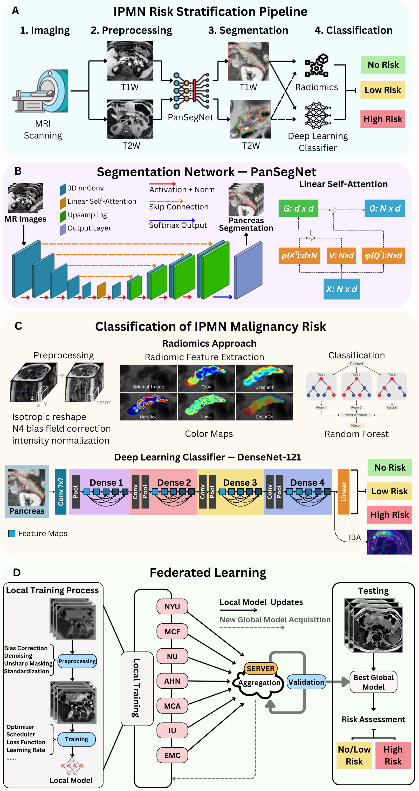

# Cyst-X: A Multi-Center MRI Benchmark and Federated Learning Framework for Malignancy-Risk Stratification of Pancreatic Cystic Neoplasm

[](https://arxiv.org/abs/2507.22017)
[](https://huggingface.co/datasets/phy710/Cyst-X/) 
[](https://huggingface.co/phy710/Cyst-X/) 
[](https://osf.io/74vfs/)

Official implementation of **Cyst-X**, an end-to-end multi-center pipeline integrating state-of-the-art pancreas segmentation, federated optimization, and classical radiomics pipelines for automated malignancy risk stratification of intraductal papillary mucinous neoplasms (IPMNs).

## Differences from v1

The original release is preserved as [GitHub code v1](https://github.com/NUBagciLab/Cyst-X/tree/v1), [dataset v1](https://huggingface.co/datasets/phy710/Cyst-X/tree/v1), and [models v1](https://huggingface.co/phy710/Cyst-X/tree/v1). Use the [current code on main](https://github.com/NUBagciLab/Cyst-X/tree/main), [dataset v2](https://huggingface.co/datasets/phy710/Cyst-X/tree/v2), and [models v2](https://huggingface.co/phy710/Cyst-X/tree/v2) for the updated workflow.

- **Image/mask orientation:** Some v1 masks did not share the orientation of their paired MRI images. These mismatches are corrected in the released v2 segmentation dataset, so preprocessing begins at step 1 (RAS conversion).
- **Classification folds:** Internal two-class models used four-fold cross-validation in v1 and are standardized to five-fold cross-validation in v2. Use the current `classification/t1_split.csv` and `classification/t2_split.csv` distributed with the v2 dataset.

The code changes can be viewed in the [v1-to-main comparison](https://github.com/NUBagciLab/Cyst-X/compare/v1...main).

---

# 📌 Overview

Pancreatic cancer is projected to be the second-deadliest cancer by 2030, making early detection critical. IPMNs are key cancer precursors, but current consensus guidelines struggle to stratify malignancy risk accurately. 

**Cyst-X** addresses this structural bottleneck by providing:
1. **The Largest Multi-Center Pancreas MRI Resource:** 1,461 abdominal MRI scans from 764 patients across seven international medical centers with expert annotations and pathology-anchored ground truth.
2. **Advanced Pancreas Segmentation:** Integrating [PanSegNet](https://github.com/NUBagciLab/PaNSegNet) (a linear self-attention transformer-based backbone) for high-fidelity region of interest (ROI) extraction.
3. **Privacy-Preserving Federated Learning:** Distributed risk classification training utilizing `FedAvg` and `FedProx` without exchanging raw clinical images.

<p align="center">
  
</p>

# 📂 Repository Structure

```text
Cyst-X/
├── Classification/
│   ├── internal/             # Five-fold internal evaluation
│   │   ├── 2-class/          # Centralized, FedAvg, FedProx, radiomics, and four fusion methods
│   │   ├── 3-class/          # Centralized three-class classification
│   │   ├── low_vs_high/      # IPMN-only high-risk versus low-risk
│   │   └── histology/        # Histopathology-confirmed IPMN cohort
│   ├── external/             # Seven-center leave-one-center-out evaluation
│   │   ├── 2-class/
│   │   ├── low_vs_high/
│   │   └── histology/
│   ├── tsne/                 # Input-image t-SNE visualization
│   ├── vs_radiologists/      # Matched reader/model comparisons across the three cohorts
│   ├── additional_analyses/  # CPU-only supplementary analyses of saved predictions
│   ├── run_radiomics.sh      # Batch launcher for the radiomics experiments
│   ├── requirements.txt
│   └── README.md
├── Segmentation/            # Pipeline and engines for pancreas ROI localization
├── preprocessing/
│   ├── step1_reorientation_to_RAS.py
│   ├── step2_n4biascorrection.py
│   ├── step3_crop.py
│   ├── step2_crop.py         # Alternative cropping/visualization implementation
│   ├── run_preprocessing.sh  # Run steps 1–3 on the aligned v2 segmentation dataset
│   ├── run_seg_crop.sh       # Crop N4 images using predicted RAS masks
│   ├── requirements.txt
│   └── README.md
├── features/
│   ├── radiomics_features_t1.csv
│   ├── radiomics_features_t2.csv
│   ├── radiomics_feature_extraction_wavelet_LoG.py  # Optional extraction script from v1
│   └── README.md
├── MRQy/                    # MRI quality analysis and UMAP inputs
├── figures/                 # Repository illustration assets
├── index.html               # Project webpage
├── LICENSE.txt
└── README.md                # Main repository documentation hub
```

Classification checkpoints and saved model outputs are distributed through the [Hugging Face model repository](https://huggingface.co/phy710/Cyst-X); MRI images, masks, labels, and split files are distributed through the [dataset repository](https://huggingface.co/datasets/phy710/Cyst-X). See the directory-specific READMEs for usage.

# 📦 Dataset Access & Download
The Cyst-X dataset includes raw/preprocessed NIfTI volumes, expert pancreas segmentation masks, center-wise stratified splits, and clinical metadata. Please download the dataset via [HuggingFace](https://huggingface.co/datasets/phy710/Cyst-X).:

First, please make sure that `huggingface_hub` is installed:
```Bash
pip install huggingface_hub
```
    
Download the full dataset, including visualization previews, with Python:
```Python
from huggingface_hub import snapshot_download
snapshot_download(
    repo_id="phy710/Cyst-X",
    repo_type="dataset",
    local_dir="/dataset"
)
```

The `visualizations/` folders are optional previews for convenient visual inspection and are not used by the training or evaluation code. To download without them, add `ignore_patterns=["**/visualizations/**"]` to the `snapshot_download()` call:

```python
snapshot_download(
    repo_id="phy710/Cyst-X",
    repo_type="dataset",
    local_dir="/dataset",
    ignore_patterns=["**/visualizations/**"],
)
```

You can also access and download the dataset mirror directly from the Open Science Framework ([OSF](https://osf.io/74vfs/)). However, uploading massive amounts of files to OSF is difficult. So we compressed the dataset into several zip files. Please organize the files according to the expected directory layout.

## Expected Directory Layout

The current Hugging Face dataset (`main` / `v2`) contains `classification/` and `segmentation/` directly under the download directory. With the `local_dir="/dataset"` example above, the layout is:

```text
/dataset/
├── classification/
│   ├── t1/
│   │   ├── images/                      # 723 N4-based cropped T1W pancreatic ROIs (.nii.gz)
│   │   └── visualizations/
│   ├── t2/
│   │   ├── images/                      # 738 N4-based cropped T2W pancreatic ROIs (.nii.gz)
│   │   └── visualizations/
│   ├── IPMN_labels_t1_total.xlsx        # T1W labels and metadata
│   ├── IPMN_labels_t2_total.xlsx        # T2W labels and metadata
│   ├── IPMN_labels_total.xlsx           # Master metadata and paired T1W/T2W labels
│   ├── t1_split.csv                     # Five-fold split for T1W and all paired fusion methods
│   └── t2_split.csv                     # Current five-fold T2W patient assignments
└── segmentation/
    ├── t1/
    │   ├── images/                      # 723 full-volume T1W scans (.nii.gz)
    │   ├── masks/                       # Corresponding masks aligned with the images
    │   └── visualizations/
    └── t2/
        ├── images/                      # 738 full-volume T2W scans (.nii.gz)
        ├── masks/                       # Corresponding masks aligned with the images
        └── visualizations/
```

Set `--data-path /dataset/classification` for the current classification experiments. Use `classification/t1_split.csv` and `classification/t2_split.csv` for the current internal five-fold evaluations; **all paired T1W/T2W fusion experiments use `classification/t1_split.csv`, applying the same T1 patient fold assignment to both modalities**. External evaluation holds out one of the seven centers at a time.

The v1 names `IPMN_Classification/` and `IPMN_images_masks/` have been replaced by `classification/` and `segmentation/`. The downloadable classification ROIs are already generated from N4-corrected images. Full-volume segmentation images and their aligned masks are the starting inputs for the [preprocessing pipeline](preprocessing/README.md), which generates RAS and N4 intermediate volumes locally; those intermediate directories are not included in the dataset download.

## Image orientation

The classification dataset is released in **RAS voxel orientation** (Right, Anterior, Superior). The full-volume segmentation dataset retains its original acquisition orientation, with each mask aligned to its corresponding image; it has not been standardized to RAS. To convert the segmentation images and masks to RAS, use [step1_reorientation_to_RAS.py](https://github.com/NUBagciLab/Cyst-X/blob/main/preprocessing/step1_reorientation_to_RAS.py).

Here, RAS follows the increasing-voxel-axis convention used by [NiBabel](https://nipy.org/nibabel/image_orientation.html) and SimpleITK's orientation helpers. The supplied script uses MONAI `Orientationd(axcodes="RAS")` and writes NIfTI files with NiBabel. For a classification image, `nib.aff2axcodes(nib.load(path).affine)` returns `('R', 'A', 'S')`; the corresponding SimpleITK check is `sitk.DICOMOrientImageFilter.GetOrientationFromDirectionCosines(sitk.ReadImage(path).GetDirection())`. **ITK-SNAP may label the same RAS-oriented volume as LPI**, because its orientation-code convention names the opposite ends of the axes. This is a difference in labeling, not an image/mask misalignment; see the [ITK orientation conventions](https://docs.itk.org/projects/doxygen/en/latest/classitk_1_1AnatomicalOrientation.html).

# 📊 Mapping Between Reported Table/Figure and the Corresponding Script

Table 1 and Supplementary Tables A2 and A3: `/Segmentation/PanSegNet/Task210_PancreasT1MRI/get_results.sh` and `/Segmentation/PanSegNet/Task211_PancreasT2MRI/get_results.sh`.

The classification references below follow the current manuscript numbering. Run the evaluation scripts from their own experiment directories with the corresponding data and saved models; see the [classification instructions](Classification/README.md).

## Table 2 — Classification AUC summaries

| Analysis | Corresponding scripts |
|---|---|
| IPMN-only high-risk versus low-risk, internal | [DenseNet-121](Classification/internal/low_vs_high/centralized/fold_test.py) and [radiomics](Classification/internal/low_vs_high/radiomics/fold_test.py) |
| IPMN-only high-risk versus low-risk, external | [DenseNet-121](Classification/external/low_vs_high/centralized/fold_test.py) and [radiomics](Classification/external/low_vs_high/radiomics/fold_test.py) |
| Broad binary high-risk versus no-/low-risk, internal | [Centralized](Classification/internal/2-class/centralized/fold_test.py), [FedAvg](Classification/internal/2-class/fedavg/fold_test.py), [FedProx](Classification/internal/2-class/fedprox/fold_test.py), and [radiomics](Classification/internal/2-class/radiomics/fold_test.py) |
| Broad binary high-risk versus no-/low-risk, external | [Centralized](Classification/external/2-class/centralized/fold_test.py), [FedAvg](Classification/external/2-class/fedavg/fold_test.py), [FedProx](Classification/external/2-class/fedprox/fold_test.py), and [radiomics](Classification/external/2-class/radiomics/fold_test.py) |
| Three-class no-risk versus low-risk versus high-risk, internal | [Three-class evaluation](Classification/internal/3-class/centralized/fold_test.py) |
| Effect of predicted segmentation ROIs, two-class | [PanSegNet ROIs](Classification/internal/2-class/centralized/fold_test_PanSegNet.py) and [Swin-UNETR ROIs](Classification/internal/2-class/centralized/fold_test_swin.py) |
| Effect of predicted segmentation ROIs, three-class | [PanSegNet ROIs](Classification/internal/3-class/centralized/fold_test_PanSegNet.py) and [Swin-UNETR ROIs](Classification/internal/3-class/centralized/fold_test_swin.py) |

For single-modality experiments, select T1W/T2W with `--t 1` / `--t 2`. The internal centralized broad-binary and three-class scripts select the network with `--model densenet121`, `resnet34`, `resnet50`, or `efficientnet_b0`. Select FedProx coefficients with `--mu 0.1` or `--mu 0.3`. Radiomics scripts use `-t 1` / `-t 2` and the supplied [feature tables](features/README.md).

Internal summaries report the mean and standard deviation of test-fold AUCs. External summaries report pooled test AUC with the mean of the seven center AUCs in parentheses. For the predicted-ROI analyses, crop N4 images using the corresponding aligned model masks with [step3_crop.py](preprocessing/step3_crop.py), then pass the resulting classification directory through `--data-path`. The AUC evaluation does not require `-c`.

## Table 3 — Comparison with radiologists

[Classification/vs_radiologists/run.sh](Classification/vs_radiologists/run.sh) launches [compare_results.py](Classification/vs_radiologists/compare_results.py). This single comparison script handles the broad paired cohort (629), IPMN-only cohort (474), and histology cohort (357), both internal and external evaluations, and both validation-selected and fixed-0.5 thresholds. It reads saved `result_calibrated.xlsx` and `result.xlsx` files for radiomics, DenseNet-121, and all four fusion methods.

The separately trained histology-model predictions are generated by `fold_test.py` under [Classification/internal/histology](Classification/internal/histology) and [Classification/external/histology](Classification/external/histology). See the [reader-comparison README](Classification/vs_radiologists/README.md) for outputs and cohort matching.

## Table 4 — Dataset composition

The cohort counts come from the dataset label workbooks and the cohort definitions in the [single-modality data loader](Classification/internal/2-class/centralized/data_loader.py), [paired data loader](Classification/internal/2-class/early_fusion/data_loader.py), and [histology data loader](Classification/internal/histology/centralized/data_loader.py). Demographic and scanner summaries are metadata summaries; a dedicated script generating the full Table 4 is not included in this checkout.

## Figures

| Figure | Corresponding scripts / inputs |
|---|---|
| Figure 3 — Broad-binary t-SNE visualization | [Input-image t-SNE](Classification/tsne/tsne.py) and [learned-feature t-SNE](Classification/internal/2-class/centralized/tsne.py) |
| Figure 4 — Internal broad-binary ROC and PR curves | Saved `result.xlsx` probabilities from the [centralized](Classification/internal/2-class/centralized/fold_test.py), [FedAvg](Classification/internal/2-class/fedavg/fold_test.py), and [FedProx](Classification/internal/2-class/fedprox/fold_test.py) evaluations. The evaluators generate individual ROC plots; the combined ROC/PR plotting script is not yet included in this checkout. |
| Figure 5 — MRQy analysis | [MRQy/MRQy.py](MRQy/MRQy.py), using [MRQy_UMAP.xlsx](MRQy/MRQy_UMAP.xlsx) |

## Supplementary classification tables

| Table | Task and modality | Corresponding experiment scripts |
|---|---|---|
| A1 | Classification cohort distribution | Current modality label workbooks, using the [single-modality](Classification/internal/2-class/centralized/data_loader.py) and [paired](Classification/internal/2-class/early_fusion/data_loader.py) cohort definitions |
| A9 | IPMN-only, T1W | `--t 1` for [internal DenseNet-121](Classification/internal/low_vs_high/centralized/fold_test.py) and [external DenseNet-121](Classification/external/low_vs_high/centralized/fold_test.py); `-t 1` for [internal radiomics](Classification/internal/low_vs_high/radiomics/fold_test.py) and [external radiomics](Classification/external/low_vs_high/radiomics/fold_test.py) |
| A10 | IPMN-only, T2W | The same `low_vs_high` scripts as A9, selecting modality 2 |
| A11 | IPMN-only, paired T1W/T2W fusion | `fold_test.py` in `early_fusion`, `late_fusion`, `siamese_fusion`, and `logit_fusion` under [internal/low_vs_high](Classification/internal/low_vs_high) and [external/low_vs_high](Classification/external/low_vs_high) |
| A12 | Broad binary, T1W | `fold_test.py` in `centralized`, `fedavg`, `fedprox`, and `radiomics` under [internal/2-class](Classification/internal/2-class) and [external/2-class](Classification/external/2-class), selecting modality 1 |
| A13 | Broad binary, T2W | The same `2-class` scripts as A12, selecting modality 2 |
| A14 | Broad binary, paired T1W/T2W fusion | `fold_test.py` in `early_fusion`, `late_fusion`, `siamese_fusion`, and `logit_fusion` under [internal/2-class](Classification/internal/2-class) and [external/2-class](Classification/external/2-class) |
| A15 | Internal T2W DenseNet-121 and radiologist-mean sensitivity/specificity with 95% CIs, 629/474/357-patient cohorts | [run_analysis.py](Classification/additional_analyses/run_analysis.py), rendered by [render_tables.py](Classification/additional_analyses/render_tables.py) as `reader_ci.tex` |
| A16 | Paired model-minus-radiologist-mean sensitivity/specificity differences with 95% CIs | [run_analysis.py](Classification/additional_analyses/run_analysis.py), rendered by [render_tables.py](Classification/additional_analyses/render_tables.py) as `paired_differences.tex` |
| A17 | Broad, IPMN-only, and histology models evaluated on the same 357 pathology-confirmed patients | [run_analysis.py](Classification/additional_analyses/run_analysis.py), rendered by [render_tables.py](Classification/additional_analyses/render_tables.py) as `frozen_histopathology.tex` |
| A18 | Broad-task internal/external AUC summaries on matched patients: pooled and seven-center mean AUC | [run_analysis.py](Classification/additional_analyses/run_analysis.py), rendered by [render_tables.py](Classification/additional_analyses/render_tables.py) as `matched_auc.tex` |

For binary test results, run `fold_test.py` once without `-c` to save `result.txt/.xlsx` at threshold 0.5, and again with `-c` to save `result_calibrated.txt/.xlsx` using the existing validation-selected thresholds. Keep the published `thresholds.json` beside the saved folds to reuse those thresholds. Fusion experiments use the paired cohort and the T1 split assignments. These manuscript tables use held-out test results; `fold_test_val.py` separately exports model-validation results.

Tables A15–A18 use saved held-out predictions without retraining or recalibrating models. See the [analysis commands](Classification/README.md#additional-supplementary-analyses) and [validation notes](Classification/additional_analyses/VALIDATION.md) for execution and reference checks.

To download the pre-trained models:
```Python
from huggingface_hub import snapshot_download
snapshot_download(
    repo_id="phy710/Cyst-X",
    repo_type="model",
    local_dir="./"
)
```
Then put the models into the folders of the corresponding tasks.

# 📝 Citation
If you use this dataset in your research, please cite our paper:

    @article{pan2025cyst,
      title={Cyst-X: A Multi-Center MRI Benchmark and Federated Learning Framework for Malignancy-Risk Stratification of Pancreatic Cystic Neoplasm},
      author={Pan, Hongyi and Durak, Gorkem and Keles, Elif and Hong, Ziliang and Seyithanoglu, Deniz and Zhang, Zheyuan and Medetalibeyoglu, Alpay and Aktas, Halil Ertugrul and Bejar, Andrea Mia and Taktak, Yavuz and others},
      journal={arXiv preprint arXiv:2507.22017},
      year={2025}
    }
